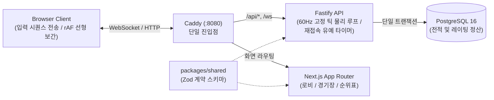

<p align="center">
  <h1 align="center">pong-pong</h1>
  <p align="center"><b>60Hz 서버 권위 물리 시뮬레이션과 클라이언트 선형 보간 기반 실시간 멀티플레이어 Pong 웹 서비스</b></p>
  <p align="center">
    
    
  </p>
</p>

---

42서울 내부 과제 비공개 규정에 따라 자체 명세로 새로 설계하고 구현해 공개한 TypeScript 기반 실시간 Pong 웹 서비스(`ft_transcendence` 변형)입니다. 브라우저는 입력만 보내고 서버가 공의 위치, 충돌, 점수, 승패를 계산하며, 매칭, 관전, 채팅, 전적과 순위표, 친구, 토너먼트, 관리자 기능을 포함합니다.

## 구성

| 경로 | 내용 |
| --- | --- |
| `packages/shared` | HTTP, WebSocket, 경기 상태 Zod schema(서버와 웹이 함께 사용) |
| `packages/db` | PostgreSQL migration, 저장소 구현, 개발용 메모리 저장소, 관리 CLI |
| `apps/api` | Fastify HTTP 서버, `ws` WebSocket 서버, 경기 simulation과 매칭 |
| `apps/web` | Next.js(App Router) 로비, 경기장, 대시보드, 순위표, 토너먼트 화면 |

`docker-compose.yml`은 `db`(PostgreSQL 16), `migrate`, `api`, `web`, `caddy`를 띄우고, Caddy가 `8080` 포트 하나로 `/api/*`, `/ws`, 웹 화면을 나눠 전달합니다.

## 서버 권위 시뮬레이션과 상태 동기화



- **60Hz(`16ms`) 서버 권위 시뮬레이션**: 공의 위치, 패들 충돌, 득점, 승패 판정은 모두 `apps/api`의 고정 틱 루프에서 계산합니다. 클라이언트는 패들 이동 의도(`up` / `down` / `neutral`)와 입력 시퀀스만 보내고, 웹 클라이언트의 HTTP API 호출과 1회용 WebSocket 티켓 발급은 `ky` 클라이언트로 처리합니다. 시뮬레이션 상태 복제는 표준 `structuredClone`을, 경계값 보정과 순위표 및 전적 정렬은 `es-toolkit`(`clamp`, `orderBy`, `sortBy`)을 사용하고, 게스트 세션과 티켓 제한은 `lru-cache` 기반 저장소로 관리합니다.
- **스냅샷 시퀀스 및 클라이언트 보간**: 서버가 보내는 상태 스냅샷마다 단조 증가 `seq`를 붙여 역전 도착 패킷을 버리고, 브라우저는 직전 스냅샷과 최신 스냅샷 사이를 선형 보간(`lerp`)합니다. `requestAnimationFrame` 루프에서 두 스냅샷 사이를 보간해 네트워크 지터가 있어도 패들과 공의 움직임을 매끄럽게 그립니다.
- **연결 단절 유예 및 트랜잭션 결산**: 경기 중 WebSocket 연결이 끊기면 방을 일시 정지(`paused`)하고 재접속 유예 타이머(`reconnectGraceMs`) 동안 세션을 유지합니다. 정상 종료 또는 기권 시에는 방 상태를 먼저 `finished`로 바꿔 중복 결산을 막고, 단일 PostgreSQL 트랜잭션으로 `match_results` 기록과 두 플레이어의 레이팅 및 전적을 함께 갱신합니다.

## 요구 환경

- Node.js `24.18.1`, pnpm `10.32.1`(`package.json`의 `engines`, `packageManager`)
- Docker Compose v2(전체 스택 실행, PostgreSQL 통합 테스트)

```sh
corepack enable
make install   # pnpm install --frozen-lockfile
```

## 실행

Compose 스택은 `POSTGRES_PASSWORD`, `SESSION_SECRET`, `APP_MODE`를 환경 변수로 받습니다. 주소는 `http://localhost:8080`입니다.

```sh
export POSTGRES_PASSWORD=<값> SESSION_SECRET=<32바이트 이상> APP_MODE=development
docker compose up --build -d   # 또는 make dev(포그라운드)
make down
```

| `APP_MODE` | 로그인 | 용도 |
| --- | --- | --- |
| `development` | `/auth/dev-login` 개발 로그인 | 등록 사용자 기능 확인 |
| `demo` | guest cookie | 비회원 PvP. 6초 안에 상대가 없으면 AI 경기로 전환. 개발 로그인, 친구, 토너먼트, 순위표, 관리자 기능은 닫힘 |
| `production`(Compose 기본값) | 개발 및 guest 로그인 없음 | `DATABASE_URL` 필수. OAuth 같은 인증 공급자가 없어 새 사용자가 로그인할 수 없음 |
| `test` | 테스트용 경로 | 자동 테스트 |

- `NEXT_PUBLIC_*` 값은 web 빌드에 들어가므로 `APP_MODE`나 공개 주소(`PUBLIC_ORIGIN`, `PUBLIC_WS_URL`)를 바꾸면 web 이미지를 다시 빌드해야 합니다.
- `demo`와 `production`은 `SESSION_SECRET`이 32바이트보다 짧으면 시작하지 않습니다.
- `DATABASE_URL`이 없으면 `production` 외 모드는 메모리 저장소를 쓰고, 재시작하면 상태를 잃습니다.

관리 CLI는 Compose 스택이 떠 있는 상태에서 같은 환경 변수로 실행합니다.

| 명령 | 하는 일 |
| --- | --- |
| `docker compose run --rm api node packages/db/dist/cli.js seed:dev` | NPC와 예시 사용자 생성(migration은 schema만 만듦) |
| `docker compose run --rm api node packages/db/dist/cli.js user:set-role <handle> admin` | 사용자 role 변경 |

## 테스트

```sh
make check   # typecheck, unit-functional, contracts, build, verify-build를 차례로 실행
make postgres-integration   # testcontainers로 PostgreSQL 컨테이너를 띄워 실행(Docker 필요)
```

`make typecheck`, `make unit`, `make contracts`, `make build`, `make verify-build`로 하나씩 실행할 수도 있습니다.

실행 중인 `development` 스택을 대상으로 하는 검사입니다. 사용자와 경기 데이터를 남기므로 버려도 되는 DB에서 실행합니다.

```sh
API_BASE_URL=http://localhost:8080/api pnpm smoke:http
API_BASE_URL=http://localhost:8080/api WS_URL=ws://localhost:8080/ws pnpm smoke:ws
E2E_BASE_URL=http://localhost:8080 API_BASE_URL=http://localhost:8080/api pnpm e2e
```

비회원 E2E(`pnpm e2e:guest-demo`)는 `demo`로 빌드한 스택에서 실행합니다. 부하 및 장애 주입 스크립트(k6, Toxiproxy)와 room scheduler 벤치마크는 `tests/load/`에 있으며 결과는 저장소에 두지 않습니다.

빌드 및 테스트 산출물은 `make clean`, `node_modules`까지는 `make fclean`, 다시 설치하고 빌드하려면 `make re`로 정리합니다.

## 범위와 제한

- 회원 가입과 운영용 인증(OAuth, OIDC, SAML)이 없습니다.
- 일부 API는 화면이 없습니다(친구 목록, 수락, 삭제, 본인 프로필 편집, 로그아웃 버튼).
- room scheduler는 API 프로세스 하나를 기준으로 하며 여러 인스턴스 사이의 방 이전은 없습니다.
- 종료 signal을 받으면 새 매칭을 거부하고 진행 중인 방을 최대 60초 기다린 뒤 닫습니다(Compose `stop_grace_period` 70초).
- 브라우저 보간은 snapshot 사이 화면을 부드럽게 할 뿐 네트워크 지연을 줄이지 않습니다.
