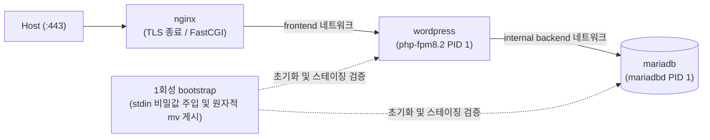

<p align="center">
  <h1 align="center">container-stack</h1>
  <p align="center"><b>직접 빌드한 nginx, WordPress, MariaDB 컨테이너 격리 및 운영 자동화 스택</b></p>
  <p align="center">
    
    
  </p>
</p>

---

42 `Inception` 과제를 변형한 Docker Compose 프로젝트입니다. 직접 빌드한 nginx, WordPress(PHP-FPM), MariaDB 이미지를 한 호스트에서 실행하고, 기동, 백업과 복원, 자격증명 교체, 진단 수집을 Makefile과 Python 도구로 관리합니다.

## 구성

| 서비스 | 역할 | 영속 상태 |
| --- | --- | --- |
| `nginx` | TLS 종료(자체 서명 인증서), WordPress로 FastCGI 전달. 호스트 포트를 게시하는 유일한 서비스 | 없음(인증서는 컨테이너마다 새로 생성) |
| `wordpress` | PHP-FPM, WP-CLI로 사이트와 계정 초기화 | `wordpress_data`, `wordpress_config` 볼륨 |
| `mariadb` | WordPress DB. 외부로 나가지 않는 `backend`(internal) 네트워크에만 연결 | `mariadb_data` 볼륨 |

- 세 이미지는 `srcs/requirements/<서비스>/Dockerfile`에서 digest로 고정한 Debian bookworm 이미지와 Debian snapshot 저장소로 빌드합니다.
- Compose 파일은 `srcs/docker-compose.yml`, 운영 도구는 `tools/`, 런타임 시나리오 테스트는 `tests/runtime_stack.py`에 있습니다.

## 격리 구조와 운영 복구 설계



- **1회성 `bootstrap` 비밀값 주입과 원자적 스테이징 게시**: 상시 실행 컨테이너에 시크릿 파일이나 평문 환경변수를 마운트하지 않고, 1회성 `bootstrap` 컨테이너의 표준입력(`stdin`)으로만 비밀값을 주입합니다. 임시 스테이징 경로에서 데이터 디렉터리와 설정을 초기화(`wp config set` 및 `wp eval` 표준 CLI 활용)하고 검증을 마친 뒤 원자적 `mv`로 게시하며, 초기화 단계별 `SIGKILL` 주입 후 재시도 수렴(`make bootstrap-test`)으로 멱등성을 검증합니다.
- **PID 1 시그널 전달(`exec`)과 네트워크 이원화(`frontend` / `backend`)**: 각 컨테이너 엔트리포인트 스크립트는 `exec`로 데몬(`mariadbd`, `php-fpm8.2 -F`, `nginx -g "daemon off;"`)에 PID 1을 넘겨 종료 시그널이 유실되지 않게 합니다. 외부 포트는 `nginx`의 `443`만 바인딩하며, `mariadb`는 외부 라우팅이 차단된 `internal: true` 속성 `backend` 브리지 네트워크에만 연결해 컨테이너 간 최소 권한 경로만 열어 둡니다.
- **4단계 무중단 자격증명 교체와 실패 롤백(`rotate-secrets`)**: 운영 중 비밀번호 교체 시 WordPress 계정, `wp-config.php`, MariaDB 계정, 호스트 시크릿 파일 순으로 갱신하며, 중간 단계 실패나 `SIGINT` 및 `SIGTERM` 수신 시 직전 단계까지 적용된 변경을 이전 시크릿 값으로 역순 롤백합니다.

## 요구 환경

- Docker Engine, Docker Compose v2
- Python 3, GNU Make, `curl`
- 첫 빌드 때 Debian snapshot과 WordPress와 WP-CLI 배포 서버 접근

`.env`와 secret 파일은 Git에 넣지 않습니다. 처음 한 번 준비합니다.

```sh
cp .env.example .env
umask 077
install -d -m 0700 secrets
printf '%s\n' '<24~128자 값>' > secrets/db_root_password.txt   # db_password, wp_admin_password, wp_user_password도 같은 방식
chmod 600 secrets/*.txt
```

- 네 값은 서로 달라야 하고, 각각 `[A-Za-z0-9_.~!@#%^+=,-]`로 된 24~128자 한 줄이어야 합니다.
- secret 디렉터리는 현재 사용자 소유이고 group 및 other 권한이 없어야 하며, secret 파일은 symlink일 수 없습니다.
- `DOMAIN_NAME`, `WORDPRESS_URL`, `HTTPS_PORT`가 같은 주소를 가리키는지는 검사하지 않습니다.

## 실행

```sh
make build
make up
make smoke
```

기본 주소는 `https://localhost`(`127.0.0.1:443`), 상태 확인 경로는 `/healthz`입니다. 모든 대상은 `PROJECT_NAME`(기본 `container-stack`), `ENV_FILE`(기본 `.env`), `WAIT_TIMEOUT`(기본 300초)을 받습니다.

| 명령 | 하는 일 |
| --- | --- |
| `make up` | secret 검증, 초기화 작업, MariaDB, WordPress, nginx 순으로 기동하고 healthy까지 대기(이미지는 빌드하지 않음) |
| `make up-build` | 빌드와 `up`을 한 번에 |
| `make start-database` / `make start-application` | MariaDB만 / WordPress와 nginx만 기동 |
| `make ps` / `make logs` | 컨테이너 상태 / 로그 |
| `make down` | 컨테이너와 네트워크만 내림(볼륨과 이미지 유지) |
| `make fclean DESTROY_CONFIRM=container-stack` | 볼륨과 로컬 이미지까지 삭제 |
| `make re DESTROY_CONFIRM=container-stack` | `fclean` 후 `up-build` |

`make up`이 중간에 실패해도 롤백하지 않습니다. `make ps`로 상태를 본 뒤 같은 명령을 다시 실행하면 남은 상태에서 목표 상태로 다시 맞춥니다. `docker compose up`을 직접 실행하면 secret 검증과 초기화를 건너뜁니다.

운영 명령은 다음과 같습니다.

| 명령 | 하는 일 |
| --- | --- |
| `make backup BACKUP_DIR=<경로>` | 세 서비스가 실행 중일 때 DB dump, WordPress 데이터와 설정 archive, SHA-256 manifest 생성 |
| `make restore PROJECT_NAME=<새 이름> BACKUP_DIR=<경로>` | 컨테이너, 볼륨, 네트워크가 없는 새 project로 복원 |
| `make rotate-secrets NEW_SECRETS_DIR=<경로>` | 새 secret 네 개로 WordPress 계정, `wp-config.php`, MariaDB 계정, 호스트 secret 파일을 차례로 교체 |
| `make diagnostics DIAGNOSTICS_DIR=<경로>` | Compose 상태, 최근 로그, 자원 설정을 secret을 가린 채 수집 |

## 테스트

```sh
make test               # .env.example 기준 Compose 구성 파싱(docker가 없으면 건너뜀)
make check-functional   # 실제 secret 없이 Compose 구성 검사
make verify             # 아래 런타임 시나리오 전체를 직렬 실행하고 테스트 자원 회수
```

런타임 시나리오는 하나씩 실행할 수도 있습니다. 모두 Docker에 별도 project를 만들어 실행합니다.

- `make e2e`: HTTPS로 WordPress 쓰기와 읽기와 MariaDB 저장값 확인
- `make bootstrap-test`: 초기화 중 `SIGKILL` 뒤 재시도
- `make persistence`: restart와 `down`/`up` 뒤 데이터 유지
- `make backup-restore-test`, `make rotation-test`, `make operations-test`: 백업과 복원, 자격증명 교체, 네트워크, 자원, 로그, 진단

## 범위와 제한

- 한 사용자, 한 Docker daemon이 관리하는 단일 호스트만 대상으로 합니다.
- 인증서는 자체 서명이며 public CA 발급과 갱신은 없습니다.
- 백업은 암호화, 예약, 보존 정책, 원격 복제를 하지 않고, nginx 인증서, 이미지, `.env`, secret 원본은 담지 않습니다.
- 자격증명 교체는 원자적이지 않습니다. 처리 가능한 실패와 SIGINT 및 SIGTERM에는 이전 값으로 되돌리기를 시도하지만 `SIGKILL`이나 호스트나 daemon 손실에는 대비하지 않습니다.
- WordPress DB 비밀번호는 `wp-config.php`에 평문으로 남고 백업에도 포함됩니다.
- MariaDB replication, point-in-time recovery, 여러 호스트 운영은 없습니다.
